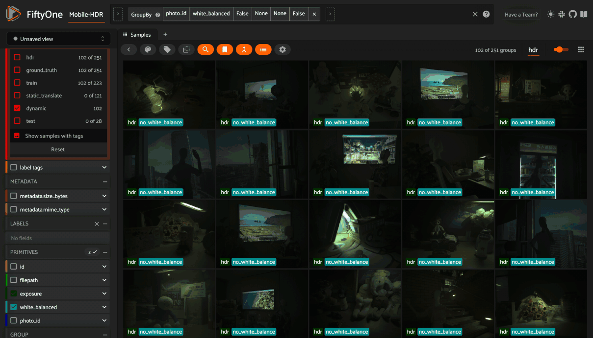

# Joint HDR Denoising and Fusion: A Real-World Mobile HDR Image Dataset in Fiftyone

<div align="center">

[](https://discord.gg/fiftyone-community)
[](https://huggingface.co/Voxel51)
[](https://voxel51.com/blog)
[](https://share.hsforms.com/1zpJ60ggaQtOoVeBqIZdaaA2ykyk)
[](https://www.linkedin.com/company/voxel51)
[](https://x.com/voxel51)
[](https://medium.com/voxel51)

</div>



This repository contains Python code that ingests the [Joint HDR Denoising and Fusion: A Real-World Mobile HDR Image Dataset](https://github.com/shuaizhengliu/Joint-HDRDN) into Fiftyone.

## Steps

### Transforming data into sRGB

This script converts the npz files into raw files, and debayers the raw files into PNGs using common heuristics.

Make sure you have all the npz files in your local directory.
```
├── Mobile-HDR
    ├── NPZ_data
         ├── training_npz
              ├── static_translate
              ├── dynamic
         ├── test_npz
              ├── test_withGT
              ├── test_withoutGT
```

Assuming `python >= 3.10` is available in your environment, run the following:
```
python -m venv venv
source venv/bin/activate

pip install -r requirements.txt

python transform_data.py
```

**Note: The script uses a gamma correction factor of 2.2 and produces two images per exposure type, one with no white balancing,
and another with white-balancing using gray-world heuristics.**

Optionally, for minimizing storage space print and optimizing speed when working with Fiftyone, you can convert the big PNG files into JPG fils by running the following:
```
source venv/bin/activate 

python compress_pngs.py
```

### Importing into Fiftyone

```
source venv/bin/activate 

python import_fiftyone.py --help
```